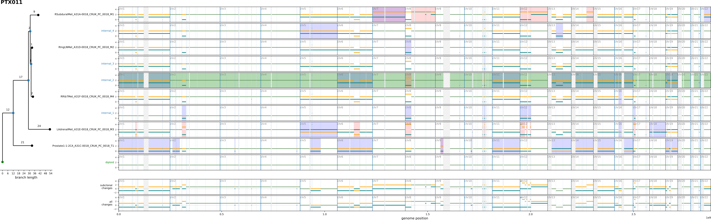
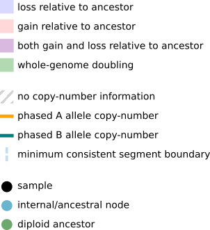
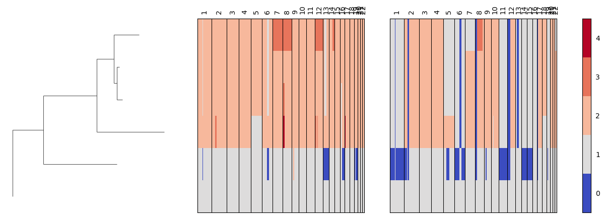

# MEDICC2 - Whole-genome doubling-aware copy number phylogenies for cancer evolution

[](https://pypi.org/project/medicc2/)
[](https://anaconda.org/bioconda/medicc2)
[](https://github.com/ICCB-Cologne/medicc2/actions/workflows/tests.yml)

For more information see the accompanying publication [Whole-genome doubling-aware copy number phylogenies for cancer evolution with MEDICC2](https://genomebiology.biomedcentral.com/articles/10.1186/s13059-022-02794-9).

# Installation
Install MEDICC2 via conda (recommended), pip or from source. MEDICC2 was developed and tested on unix-built systems (Linux and MacOS). For Windows users we recommended WSL2.

Note that the notebooks and examples are not included when installing from conda or pip.

For all installation methods you need to make sure to have a working version of the GNU Compiler Collection (`gcc`, `gxx` as well as related packages such as `libgcc-ng`) installed.

MEDICC2 requires Python >= 3.10, numpy >= 2.0, pandas >= 2.2, scipy, matplotlib, Biopython and PyYAML, and it is built with Cython >= 3.0 against OpenFST 1.8.4. It is tested with Python 3.12, numpy 2.5, pandas 3.0, Cython 3.1 and OpenFST 1.8.4 (the versions in `doc/medicc2.yml`). MEDICC2 infers tree topologies with [FastME](http://www.atgc-montpellier.fr/fastme/) (version 2.1.6 or later, conda package `fastme` from bioconda), which has to be installed separately when MEDICC2 is installed with pip; it is not needed if a tree is supplied with `--tree` or neighbour joining is selected with `--tree-method nj`. If FastME is not found (or there are fewer than 4 samples), MEDICC2 shows a warning and uses neighbour joining instead. Optional dependencies are `joblib` for running on multiple cores (`--n-cores`) and `pyranges` for overlapping events with regions of interest (`--chromosomes-bed`, `--regions-bed`). With pip they can be installed as extras, e.g. `pip install "medicc2[parallelization,events]"`.


## Installation via conda (recommended)
It is best to use a dedicated conda environment for your MEDICC2 installation with `conda create -n medicc_env`.

After activating the environment with `conda activate medicc_env` you can install MEDICC2 via `conda install -c bioconda -c conda-forge medicc2`.

## Installation via pip
As MEDICC2 relies on OpenFST version 1.8.4 which is not packaged on PyPi you have to first install it using conda with `conda install -c conda-forge openfst=1.8.4`, together with FastME (`conda install -c bioconda fastme`). Next you can install MEDICC2 via `pip install medicc2`.

## Installation from source
Clone the MEDICC2 repository and its submodules using `git clone --recursive https://github.com/ICCB-Cologne/medicc2.git`. It is important to use the `--recursive` flag to also download the modified OpenFST submodule.

All dependencies including OpenFST (v1.8.4) and FastME should be directly installable via conda. A yaml file with a suggested MEDICC2 conda environment is provided in 'doc/medicc2.yml'. You can create a new conda environment with all requirements using `conda env create -f doc/medicc2.yml -n medicc_env`.

Then, inside the `medicc2` folder, run `pip install .` to install MEDICC2 to your environment. To build the extensions in place instead (for running `./medicc2` directly from the repository), run `python setup.py build_ext --inplace` with the conda environment activated.

### Profile-guided compilation (PGO)

For faster native-engine calculations, source installations can use GCC profile-guided
optimization. PGO compiles an instrumented engine, records how representative data exercise
it, then recompiles using those profiles. In our three 100-sample matrix benchmarks,
PGO alone reduced calculation time by approximately 8%; gains depend on the workload.
The algorithm and numerical model are unchanged, and no additional memory allocator is required.
PGO currently supports Linux with GCC (tested with GCC 11.5). The build checks
the platform and the configured C++ compiler before compiling with PGO. The macOS
PGO implementation is pending; macOS users should leave `MEDICC_PGO` unset and
use the standard installation commands above. Other compilers, including Clang
on Linux, are not yet supported for PGO.

After installing the dependencies above, run the following from the repository root in
the activated environment. The editable installation makes the final compiled engine
available to both the `medicc2` command and Python imports:

```bash
export CC=gcc CXX=g++
python -m pip install --no-build-isolation -e .
mkdir -p build
export MEDICC_PGO_DIR="$(mktemp -d "$PWD/build/pgo.XXXXXX")"

# First pass: compile with profiling instrumentation.
MEDICC_PGO=generate python setup.py build_ext --inplace --force

# Collect profiles; replace this example with representative small datasets.
python medicc2 examples/simple_example/simple_example.tsv build/pgo-training \
    --tree-method nj --plot none --no-plot-tree -j 1

# Second pass: compile the optimized engine using the collected profiles.
MEDICC_PGO=use python setup.py build_ext --inplace --force
unset MEDICC_PGO_DIR
```

Run additional training datasets before the second pass to cover the modes you use,
such as total copy numbers, `--no-wgd` or `--events`. The bundled example verifies the
workflow; representative datasets are needed for useful optimization. Training runs
must finish normally so GCC can write the profiles.

Keep the source, compiler, Python environment and build directory the same between
passes. Missing or incompatible profiles cause the optimized build to fail. Repeat
both passes with a fresh profile directory after changing the C++ source or toolchain.
The final engine needs no PGO environment variables at runtime. A later ordinary
rebuild or reinstall can replace it; rerun this workflow to retain PGO. To return to
the standard build, run `python setup.py build_ext --inplace --force` with
`MEDICC_PGO` unset.

## Development mode
If you want to make changes to the MEDICC2 source code, install MEDICC2 as explained above in "Installation from source" but install in editable mode (with `pip install -e .`). Any changes to the local files will now be reflected in your environment.

# Usage
After installing MEDICC2, you can use MEDICC2 functions in python scripts (through `import medicc`) and from the command line. General usage from the command line is `medicc2 path/to/input/file path/to/output/folder`. Run `medicc2 --help` for information on optional arguments.

Logging settings can be changed using the `medicc/logging_conf.yaml` file with the standard python logging syntax.

## Command line Flags

* `input_file`: path to the input file
* `output_dir`: path to the output folder
* `--version`: Print version information
* `--input-type`, `-i`: Choose the type of input: f for FASTA, t for TSV. Default: 'TSV'
* `--input-allele-columns`, `-a`: Name of the CN columns (comma separated) if using TSV input format. This also adjusts the number of alleles considered (min. 1, max. 2). Default: 'cn_a, cn_b'
* `--tree`: Do not reconstruct tree, use provided tree instead (in newick format) and only perform ancestral reconstruction. Default: None
* `--tree-method`: Method to infer the tree topology from the pairwise distances: 'fastme' (FastME balanced minimum evolution, refined with FastME's NNI and SPR moves) or 'nj' (neighbour joining, the method of earlier MEDICC2 versions). Bootstrap runs use the same method. Default: 'fastme'
* `--fastme`: FastME executable (name on `PATH` or path) for `--tree-method fastme`. If it is not found, a warning is shown and neighbour joining is used instead. Default: 'fastme'
* `--topology-only`, `-s`: Output only tree topology, without reconstructing ancestors. Default: False
* `--nni-mode`: Refine the tree topology with nearest-neighbour interchanges, see "Topology refinement (NNI)" below. Not available with `--topology-only`. Default: False
* `--nni-max-iter`: Maximum number of candidate topologies evaluated by `--nni-mode` (at least 1). Default: no limit
* `--normal-name`, `-n`: ID of the sample to be treated as the normal sample. Trees are rooted at this sample for ancestral reconstruction. If the sample ID is not found, an artificial normal sample of the same name is created with CN states = 1 for each allele. Default: 'diploid'
* `--exclude-samples`, `-x`: Comma separated list of sample IDs to exclude. Default: None
* `--filter-segment-length`: Removes segments that are smaller than specified length (measured in bp's). Default: None
* `--bootstrap-method`: Bootstrap method. Has to be either 'chr-wise' or 'segment-wise'. Default: 'chr-wise'
* `--bootstrap-nr`: Number of bootstrap runs to perform (at least 5). Default: None
* `--prefix`, '-p': Output prefix to be used. None uses input filename. Default: None
* `--no-wgd`: Disable whole-genome doubling events (model with losses and gains only). Default: False
* `--plot`: Type of copy-number plot to save. 'bars' is recommended for <50 samples, heatmap for more samples, 'auto' will decide based on the number of samples, 'both' will plot both and 'none' will plot neither. (default: auto).
* `--no-plot-tree`: Disable plotting of tree figures. Default: False
* `--total-copy-numbers`: Run for total copy number data instead of allele-specific data (one copy-number column, normal copy number 2). Default: False
* `-j`, `--n-cores`: Number of cores to run on. Default: None
* `--events`: Whether to infer copy-number events. See section "Event Reconstruction" below
* `--chromosomes-bed`: BED file for chromosome regions to compare copy-number events to
* `--regions-bed`: BED file for regions of interest to compare copy-number events to
* `-v`, `--verbose`: Enable verbose output. Default: False
* `-vv`, `--debug`: Enable more verbose output Default: False
* `--maxcn`: Expert option: maximum CN at which the input is capped. Does not change the model. The maximum possible value is 8. Default: 8
* `--prune-weight`: Expert option: Prune weight in ancestor reconstruction. Values >0 are not supported by the built-in model yet (work in progress) and are only accepted together with `--fst`. Default: 0
* `--fst`: Expert option: path to a custom FST that replaces the built-in model, see "Copy-number model" below. Not available with `--events`. Default: None
* `--wgd-x2`: Expert option: no effect, the built-in model always treats a WGD as a x2 operation (kept for compatibility). Default: False

The options `--input-chr-separator`, `--fst-chr-separator` and `--native` were removed: chromosomes are always
separated by `X` and the native model is the default.


## Input files
Input files can be either in fasta or tsv format:

* **tsv (recommended):** Files should have the following columns: `sample_id`, `chrom`, `start`, `end` as well as columns for the copy numbers. MEDICC expects the copy number columns to be called `cn_a` and `cn_b`. Using the flag `--input-allele-columns` you can set your own copy number columns. If you want to use total copy numbers, make sure to use the flag `--total-copy-numbers`. Important: MEDICC2 does not create total copy numbers for you. You will have to calculate total copy numbers yourself and then specify the column using the `--input-allele-columns` flag.
* **fasta:** A description file should be provided to MEDICC. This file should include one line per file with the name of the chromosome and the corresponding file names. If fasta files are provided you have to use the flag `--input-type fasta`.

Note that MEDICC2 needs at least 2 non-diploid samples to create a tree.

MEDICC2 follows the BED convention for segment coordinates, i.e. segment start is at 0 and the segment end is non-inclusive.

The folder `examples/simple_example` contains a simple example input both in fasta and tsv format.
The folder `examples/OV03-04` contains a larger example consisting of multiple fasta files. If you want to run MEDICC on this data run `medicc2 examples/OV03-04/OV03-04_descr.txt path/to/output/folder --input-type fasta`.

**Note that MEDICC2 requires a consistent segmentation across all samples**. That means that all segments must have the exact same segments.


## Output files
MEDICC creates the following output files:

* `_final_tree.new`, `_final_tree.xml`, `_final_tree.png`: The final phylogenetic tree in Newick and XML format as well as an image
* `_pairwise_distances.tsv`: A NxN matrix (N being the number of samples) of pairwise distances calculated with the symmetric MEDICC2 distance (from every pair of samples). This matrix is used to create the phylogenetic tree with FastME (balanced minimum evolution with FastME's NNI and SPR refinement) or, with `--tree-method nj`, neighbor joining. Note that this distance matrix is different from the distances in the final tree due to the inferred ancestral states present in tree; to get the pairwise distances from the final tree, we recommend using an external tool such as the "cophenetic.phylo" function from the "ape" package in R.
* `_final_cn_profiles.tsv`: Copy-number profiles of the input as well as the newly internal nodes. Also includes additional information such as whether a gain or loss has happened.
* `_cn_profiles.pdf`: Combined plot of the phylogenetic tree as well as the copy-number profiles of all samples (including the internal nodes)
* `_branch_lengths.tsv`: List of all branches and their corresponding lenghts of the final tree
* `_summary.tsv`: Contains summary information about the created tree. If the `--events` flag was set, this includes the WGD status.
* `_nni_trace.tsv` (only with `--nni-mode`): One row per accepted NNI step with the step number (0 is the start tree), the tree length and the number of candidate topologies evaluated so far.

*optional (see "Event Reconstruction" below)*

* `_copynumber_events_df.tsv`: List of all copy-number events detected. The entries for WGD events have non-meaningful values for chrom, cn_child, etc. Note that the events derived are not unambiguous.
* `_events_overlap.tsv`: Overlap of copy-number events with regions of interest


## Output plots
Apart from the file `_tree.pdf` which contains the inferred phylogeny, the main plot created by MEDICC is the copy-number plots named either `_cn_profiles.pdf` or `_cn_profiles_heatmap.pdf`.
The left part consists of the inferred phylogenetic tree including the number of events in the branches. The right part is made up of the copy-number profiles of the samples (and potentially the reconstructed ancestral nodes).

There are two kinds of copy-number plots: the bars and the heatmap version. The bars version is most suitable for fewer samples (<50) as more details are visible while the heatmap version is most suitable many samples expected for example in single-cell experiments.
You can toggle the kind of plot MEDICC2 creates with the `--plot` flag (see above).

### Example bars copy-number plot
Example from patient PTX011 from the Gundem et al. Nature 2015. The data can be found in `example/gundem_et_al_2015/`.



**Legend**



### Example heatmap copy-number plot
Example from patient PTX011 from the Gundem et al. Nature 2015. The data can be found in `example/gundem_et_al_2015/`.




## Usage examples
For first time users we recommend to have a look at `examples/simple_example` to get an idea of how input data should look like. Then run `medicc2 examples/simple_example/simple_example.tsv path/to/output/folder` as an example of a standard MEDICC run. Finally, the notebook `notebooks/example_workflows.py` shows how the individual functions in the workflow are used.

The notebook `notebooks/bootstrap_demo.py` demonstrates how to use the bootstrapping routine and `notebooks/plot_demo.py` shows how to use the main plotting functions.


## Copy-number model
MEDICC2 uses a native OpenFST model: losses (including LOH) and gains before, between and after up to two
whole-genome doublings per branch. A WGD doubles every copy number (capped at 8) and costs 1 for the whole
genome, every other event costs 1. Copy numbers are capped at 8 and ancestors are reconstructed without pruning.
Distances, ancestors and events are computed by a C++ engine that is built together with the other extensions
(`python setup.py build_ext --inplace` or `pip install .`).

```
medicc2 examples/simple_example/simple_example.tsv output_folder
medicc2 --total-copy-numbers -a cn input.tsv output_folder
medicc2 --no-wgd --events --chromosomes-bed default input.tsv output_folder
```

* Allele-specific and total copy numbers (`--total-copy-numbers`, one column, normal CN 2) use the same model:
  a WGD doubles the total copy number as well (3 -> 6 is one event), and unit gains and losses change it by one.
* `--no-wgd` restricts the model to gains and losses.
* `--events` writes one minimum-cost event history per branch; the number of events of a branch equals its length.
* `-j` uses threads for the pairwise distances and the ancestor reconstruction. A single tumour sample is accepted.
* `--prune-weight` values above 0 are not supported yet (work in progress) and `--wgd-x2` has no effect.

**Custom FSTs.** `--fst PATH` replaces the built-in model with an FST in OpenFST format, which is loaded with
fstlib and scored by FST composition. The FSTs of MEDICC2 1.x are still shipped in `medicc/objects`
(e.g. `wgd_asymm.fst`, the previous default model, and `no_wgd_asymm.fst`). `--no-wgd` and `--total-copy-numbers`
do not change a custom FST, and `--events` is not available with `--fst` because an arbitrary FST has no event labels.

In python, `fst = medicc.io.read_fst()` returns the native model (optionally with `total_copy_numbers=True` or
`no_wgd=True`) and `medicc.io.read_fst(user_fst=PATH)` loads a custom FST; pass it to `medicc.main` as usual.


## Topology refinement (NNI)
By default the tree is built with FastME (balanced minimum evolution, refined with FastME's own NNI and SPR moves,
fixed seed) from the pairwise distances; `--tree-method nj` uses neighbour joining instead and `--tree` supplies a
tree. The ancestors are reconstructed on that topology. With `--nni-mode` MEDICC2 then searches for a shorter tree
with nearest-neighbour interchanges (NNI): at every internal edge two subtrees are swapped (two moves per edge; the normal
sample stays the outgroup). Every candidate topology is scored by a full ancestor reconstruction and its total tree
length. Each sweep evaluates all neighbours of the current tree that were not evaluated before and moves to the best
strictly shorter one; the search stops at a local optimum or after `--nni-max-iter` evaluated candidates. Ties are
broken by the order of the moves, so the result does not depend on `-j`. The final tree, ancestors, branch lengths
and events are those of the refined tree, and `_nni_trace.tsv` lists the accepted steps.

```
medicc2 --nni-mode --nni-max-iter 500 -j 4 input.tsv output_folder
```

A sweep costs one ancestor reconstruction per neighbour (about 2 x the number of internal edges), so NNI is much
slower than a normal run on larger trees; `--nni-max-iter` bounds the cost. NNI also works with `--fst`
(scored with the custom FST). Bootstrap runs (`--bootstrap-nr`) do not use NNI. In python, pass `nni=True`
(and optionally `nni_max_iter`) to `medicc.main`.


## Event Reconstruction
MEDICC2 can create a list of copy-number events in the file `_copynumber_events_df.tsv` which are also displayed in the final copy-number barplot.
These are disabled by default and are enabled using the `--events` flag.

Note, that the inferred events are not unambigous but just one possible solution. In some cases there are multiple possible paths that can result in the same final copy-number state in the same number of steps. Without additional information, MEDICC2 cannot determine which possible path is the right one and reports one minimum-cost history per branch.
Even though the events inferred by MEDICC2 are not unambigous they are minimal (as in there are no solutions with fewer number of steps) and deterministic (as in multiple runs of MEDICC2 will always return the same events).

Minimal example: *111 -> 232* which can be explained by *gain-gain-gain* + *x-gain-x* or *gain-gain-x* + *x-gain-gain*.

Therefore subsequent analysis on the reconstructed events can potentially be influenced by artifacts and most be treated with caution.


### Regions of interest
MEDICCC2 can overlap the inferred events with regions of interest such as chromosome arms or oncogenes. 
This process requires the installation of `pyranges` (for example with `pip install pyranges` or `pip install "medicc2[events]"`).
The overlap is turned off by default. You can turn on the overlapping with the ``--chromosomes-bed` and `--regions-bed` flag by providing bed-files with regions of interest. By default MEDICC2 uses hg38 chromosome-arms and a list of genes taken from Davoli et al. Cell 2013. This data is present as BED files in the `medicc/objects` folder. Invoke these using the flags `--chromosomes-bed "default"` and/or `--regions-bed "default"`.
Users can specify regions of interest of their own in BED format by providing the `--chromosomes-bed` or `--regions-bed` flags.


## Single sample WGD detection
If you are interested in the WGD status of individual samples, run MEDICC2 with `--events` on the sample together with the normal (a single tumour sample is accepted): WGD events are listed in `_copynumber_events_df.tsv` and the summary file names the branches with a WGD. The FST-based single-sample WGD detection of MEDICC2 1.x (`medicc.core.detect_wgd`) was removed together with the bundled default FSTs. The notebook `notebooks/WGD_detection.ipynb` demonstrates WGD calling with the native model: WGD calls on the tree, the number of events a WGD saves on each branch, a per-sample check against the normal and a branch with two WGDs.


# Issues
If you experience problems with MEDICC2 please [file an issue directly on Bitbucket](https://bitbucket.org/schwarzlab/medicc2/issues/new) or [contact us directly](chenxi.nie@iccb-cologne.org). 

## Known Issues

**Phasing**
We do recommend to phase your input data before using MEDICC2. MEDICC2's own phasing algorithm is only to be used when looking at single samples and should not be used in the case of multiple samples! Here we recommend using Refphase ([Bitbucket](https://bitbucket.org/schwarzlab/refphase/)).
If phasing is not possible for you, working on major/minor configuration works reasonably well in most cases.
For very noisy data, where accurate phasing cannot be guaranteed, you can also try to create total copy numbers and run MEDICC2 with the `--total-copy-numbers` flag.

**long runtime**
MEDICC2 tries to solve an NP-hard problem by inferring a symmetric distance between samples and therefore has a higher runtime than other tools than only compute the asymmetric (and less accurate) distance between samples.

In order to improve runtime, you should first run MEDICC2 with multiple cores using the `--n-cores` flag. Using multiple cores will roughly lead to a decrease in runtime linear w.r.t. numbers of cores used (depending on your system architecture).

Next, you can remove duplicate and diploid cells. Especially in the case of 100s to 1000s single-cell samples, there are oftentimes multiple copies of cells with the same copy-number profiles as well as cells that are (almost) purely diploid. Removing those will (in most cases) not alter the results but decrease runtime.

Finally, MEDICC2's runtime scales with the number of segments used. If you use copy-number bins, try to increase the bin-size for decreased runtime as well as merge neighboring bins that are equal in copy-number states across all samples. (For example a chromosome that is purely diploid in all samples should be represented as a single segment rather than multiple bins).
If you instead create a minimum consistent segmentation, be aware of individual samples with many breakpoints that will drive up your total number of breakpoints and therefore number of segments. If individual samples have an excessive amount of breakpoints, it is best to remove them before creating a minimum consistent segmentation.

**Noisy segments**
Small faulty or noisy segments can have a strong effect on the distances MEDICC2 calculates between samples and therefore the resulting tree.
This is because MEDICC2 counts all segments equally in order appropriatlely take focal events into account. 
If the resulting and the inferred events look strange to you, you can replot the tree and copy-number profiles using the function `plot_cn_profiles` setting `ignore_segment_lengths=True` (see the notebook `notebooks/plot_demo.py` for usage examples) in order to investigate small segments that might not have been visible in the original plot.
If you are unsure about the copy-number profiles we recommened to filter small segments.

**Taxon imbalance**
If your data contains 100s to 1000s samples with a few distinct subgroups, an imbalance in the number of samples per subgroups might lead to an incorrect tree (e.g. 50 samples of subclone A and 1000 samples each of subclone B and C).
This is a known problem in phylogeny called *taxon imbalance* or *taxon sampling*. If you have multiple, clearly separable subgroups in your data we recommoned either subsampling over-represented groups or upsampling under-represented groups to gauge the effect of taxon imbalance.

**Running out of memory / bad_alloc error**
If MEDICC2 terminates with the following error `terminate called after throwing an instance of 'std::bad_alloc'` or your machine runs out of memory this hints towards an issue with the FST.
Rerun MEDICC2 with the `-vv` flag to enable extended logging. If the error occurs during the ancestral reconstruction routine, the issue is related to OpenFST which is the FST library employed by MEDICC2 and cannot be easily solved by us.
This issue can be related to small bin sizes (and therefore a large number of segments). Increasing the binsize (although decreasing accuracy) solves this issue most of the time.
You can also try to remove the sample that led to the error (see the extended logs for this). 

**The output plots are not like I expected**
Maybe you need to set the `--plot` flag. By default, `--plot` is set to auto which means that it plots different figures depending on the number of samples in the data (threshold is 50); see above.

**missing segments / gaps in the segmentation**
MEDICC2 will assume that the segmentation is gap-less, i.e. that gaps between neighboring segments are neglible. If your data contains large gaps this might affect the performance of MEDICC2 as it might incorrectly jointly mutate segments that are actually separated.


# Bugs, feature requests and contact
You can report bugs and request features directly in [Bitbucket](https://bitbucket.org/schwarzlab/medicc2/issues) or contact us via at *chenxi.nie@iccb-cologne.org*.


# License
MEDICC2 is available under [GPLv3](https://www.gnu.org/licenses/gpl-3.0.en.html). It contains modified code of the *pywrapfst* Python module from [OpenFST](http://www.openfst.org/) as permitted by the [Apache 2](http://www.apache.org/licenses/LICENSE-2.0) license.


# Kaufmann et al. 2022 Publication
The MEDICC2 model has been published in 2022 with Genome Biology: [MEDICC2: whole-genome doubling aware copy-number phylogenies for cancer evolution](https://doi.org/10.1186/s13059-022-02794-9).

## Figures
Both the required data and the scripts to create all Figures from the publication are stored in the commit version *9b400ef* of the MEDICC2 repository available on [Zenodo](https://zenodo.org/record/7300106) in the folder `Figures_Kaufmann_et_al_2021/`.

## Simulation Validation
The simulated copy-number profiles used in the MEDICC2 publication were created using our simulation framework [Simphyni](https://bitbucket.org/schwarzlab/simphyni/src/main/). The Simphyni repository contains a notebook to recreate the exact data used in the publication.

## Please cite
Kaufmann, T.L., Petkovic, M., Watkins, T.B.K. et al.  
**MEDICC2: whole-genome doubling aware copy-number phylogenies for cancer evolution**.  
Genome Biol 23, 241 (2022). https://doi.org/10.1186/s13059-022-02794-9

Schwarz RF, Trinh A, Sipos B, Brenton JD, Goldman N, Markowetz F.  
**Phylogenetic quantification of intra-tumour heterogeneity.**  
PLoS Comput Biol. 2014 Apr 17;10(4):e1003535. doi: 10.1371/journal.pcbi.1003535.
